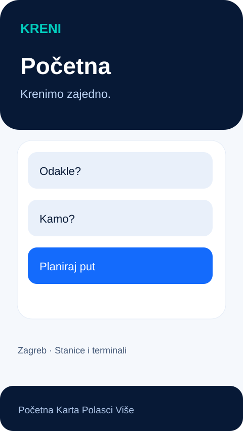
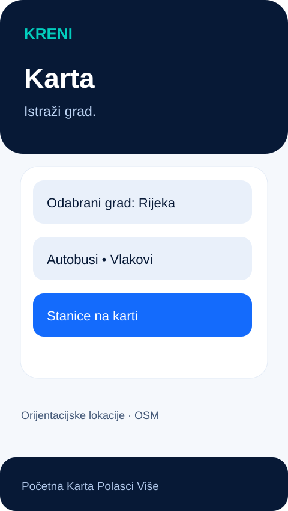
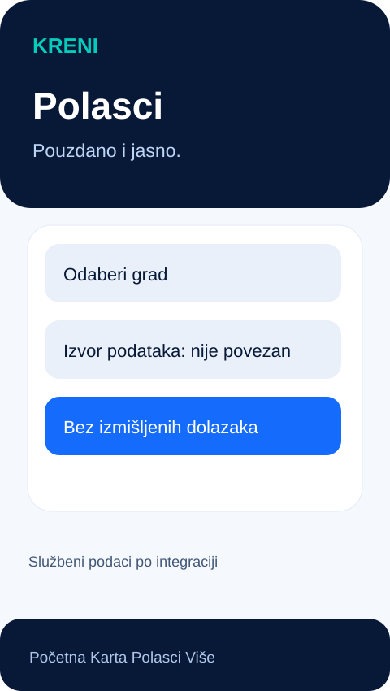
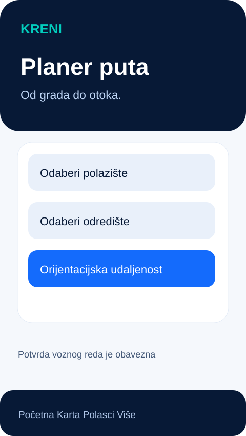
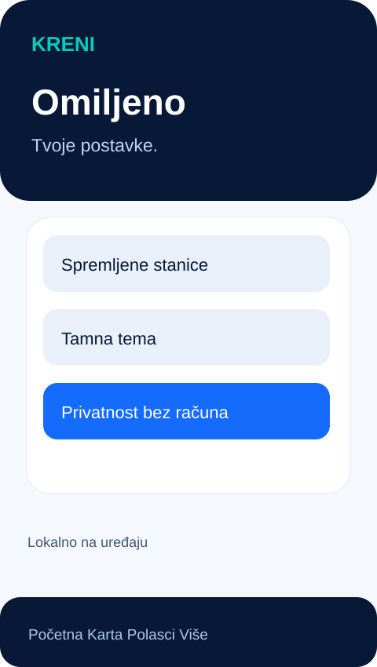
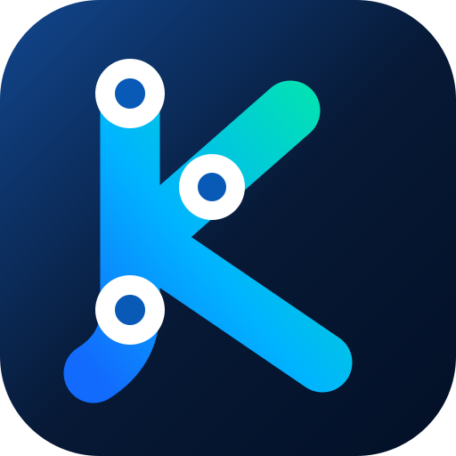

<div align="center">
  

  # Cijela Hrvatska. Jedno putovanje.

  **Autobusi · Tramvaji · Vlakovi · Trajekti · Katamarani**

  [](https://flutter.dev/)
  [](https://github.com/bren-wp/KRENI/actions/workflows/release.yml)
  [](https://github.com/bren-wp/KRENI/releases)
  [](LICENSE)
  

  **[Izdanja](https://github.com/bren-wp/KRENI/releases)** · **[Razvoj](docs/DEVELOPMENT.md)** · **[Izvori podataka](docs/DATA_SOURCES.md)** · **[Privatnost](docs/PRIVACY.md)**
</div>


## 🚏 Jedna aplikacija. Više načina putovanja.

**KRENI** je neovisni projekt za jednostavnije snalaženje u javnom prijevozu Hrvatske: od riječkih i splitskih autobusa, preko zagrebačkih i osječkih tramvaja, do vlakova te trajekata i katamarana na Jadranu. Jedan prepoznatljiv dizajn, jedan izbor grada i lako dostupne lokacije postaja, kolodvora i luka.

Trenutačno je riječ o **razvojnoj verziji v0.0.1**. Aplikacija prikazuje informativne lokacije, interaktivnu OpenStreetMap kartu, lokalne favorite i osnovni prikaz planera. Službeni vozni redovi i GPS podaci uživo **još nisu integrirani**. Dizajnerski prikazi ispod konceptualni su i nisu snimke potvrđenih polazaka.

## ✨ Pregled zaslona

<table>
  <tr><td align="center"><strong>Početna</strong><br/></td><td align="center"><strong>Karta</strong><br/></td><td align="center"><strong>Polasci</strong><br/></td></tr>
  <tr><td align="center"><strong>Planer</strong><br/></td><td align="center"><strong>Omiljeno i postavke</strong><br/></td><td align="center"><strong>Jednostavan dizajn</strong><br/></td></tr>
</table>

## 🚍 Što je dostupno u v0.0.1?

- **Android i iOS** — zajednička Flutter aplikacija s Material 3 sučeljem.
- **Karta** — OpenStreetMap podloga s filtrima za vrste prijevoza i orijentacijskim lokacijama.
- **Gradovi** — početni katalog gradova i terminala; izbor grada sprema se lokalno.
- **Omiljene lokacije** — označi zvjezdicom i brzo pronađi spremljene terminale.
- **Planer (osnovni)** — izbor polazišta i odredišta te *zračna udaljenost*, jasno razlikovana od prometne rute.
- **Polasci** — siguran HTTPS/JSON adapter spreman za integraciju dozvoljenih izvora; bez izmišljanja vremena.
- **Privatnost** — bez korisničkog računa, analitike, vlastite baze podataka, Firebasea ili Supabasea.
- **Izgled** — svijetla i tamna tema, prilagođeno manjim i većim zaslonima.

## 🌊 Hrvatska povezana kopnom i morem

| Način prijevoza | Planirane integracije |
| --- | --- |
| 🚌 Gradski i međugradski autobusi | Autotrolej, ZET, Promet Split i drugi |
| 🚋 Tramvaji | Zagreb (ZET) i Osijek (GPP) |
| 🚆 Željeznica | HŽ Putnički prijevoz |
| ⛴️ Trajekti | Jadrolinija i drugi brodari |
| 🚤 Katamarani | Jadrolinija, TP Line, Krilo i drugi |

Navođenje prijevoznika označava **planirane izvore**, ne potvrđeno partnerstvo ili dovršenu integraciju. Za svaki izvor prije puštanja u rad treba potvrditi dopuštenje za pristup, licencu, kvalitetu i pravila osvježavanja.

## ⚡ Pokretanje

Za razvoj su potrebni Flutter SDK i Android SDK (za Android), odnosno macOS/Xcode (za iOS).

```bash
git clone https://github.com/bren-wp/KRENI.git
cd KRENI
flutter create --org hr.brendigo --project-name kreni --platforms android,ios .
flutter pub get
flutter run
```

Za povezivanje autoriziranog HTTPS/JSON izvora:

```bash
flutter run --dart-define=KRENI_FEED_URL=https://example.org/approved-departures.json
```

Ovo je **samo primjer ugovora podataka**; URL nije stvarni servis. JSON shema: `{"departures":[{"stop_id":"zg-glavni","line":"A","destination":"Primjer","departure_time":"2026-10-10T12:00:00+02:00","source":"Naziv izvora"}]}`. Tek nakon povezivanja legitimnog izvora mogu se prikazati stvarni polasci. Više: [docs/DATA_SOURCES.md](docs/DATA_SOURCES.md).

## 🧪 Provjere i izdavanje

Workflow [release.yml](.github/workflows/release.yml) provodi Flutter analizu, testove, Android APK build i iOS build **bez potpisivanja**. Nakon uspjeha na grani `main` automatski objavljuje **v0.0.1 pre-release** (ako izdanje ne postoji). Android release APK je testni artefakt; iOS ZIP sadrži *nepotpisanu* aplikaciju, nije instalacijski IPA/App Store paket.

Izdanja se ne smiju smatrati spremnima za trgovine aplikacija dok ne prođu provjere na stvarnim uređajima, potpisivanje i provjeru izvora podataka.

## 🔒 Privatnost i neovisnost

Postavke i omiljene lokacije pohranjuju se lokalno u privatnu JSON datoteku. Ne koristimo vlastitu poslužiteljsku bazu, praćenje korisnika ni obavezne korisničke račune. Prikaz karte zahtijeva mrežni pristup kartografskom poslužitelju (vidi [privatnost](docs/PRIVACY.md)). Projekt nije službena aplikacija navedenih prijevoznika.

## 💙 Brendigo

**KRENI** je otvoreni projekt tvrtke/brenda **Brendigo**, pod [MIT licencom](LICENSE). Dizajniran s naglaskom na jasne informacije, pristupačnost i mogućnost budućeg proširenja na javni prijevoz cijele Hrvatske.

<sub>© 2026 Brendigo · Izvorni kod i identitet KRENI.</sub>
