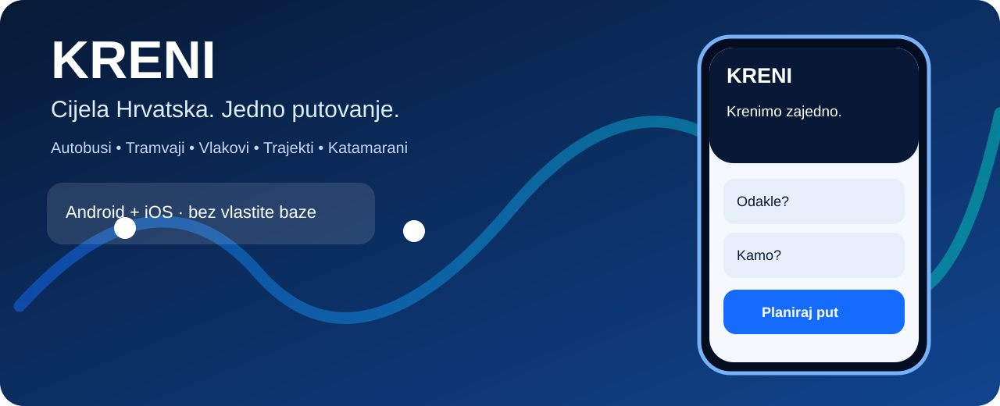
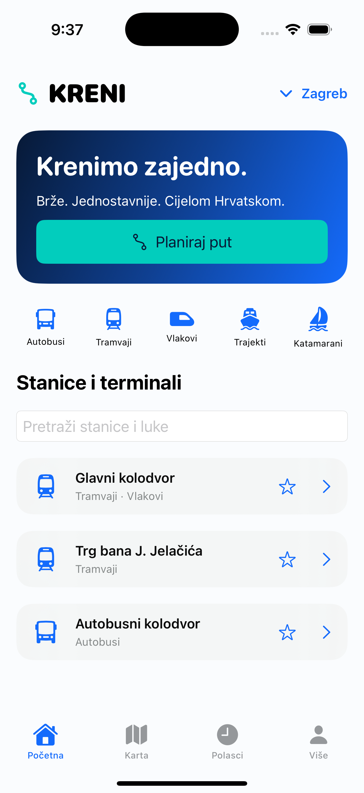
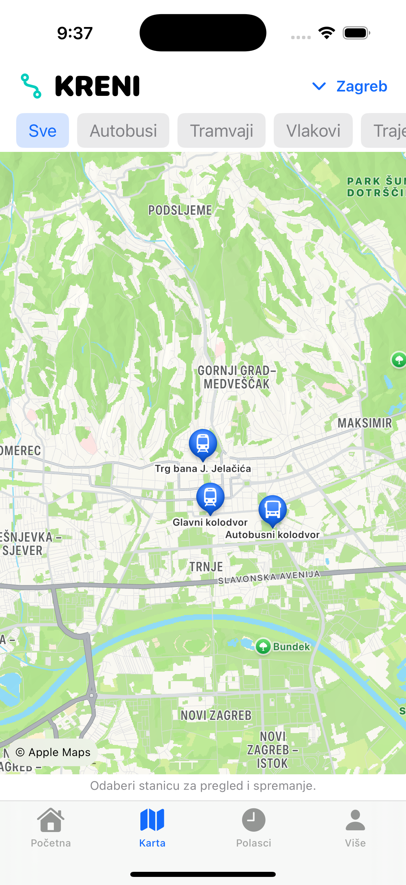
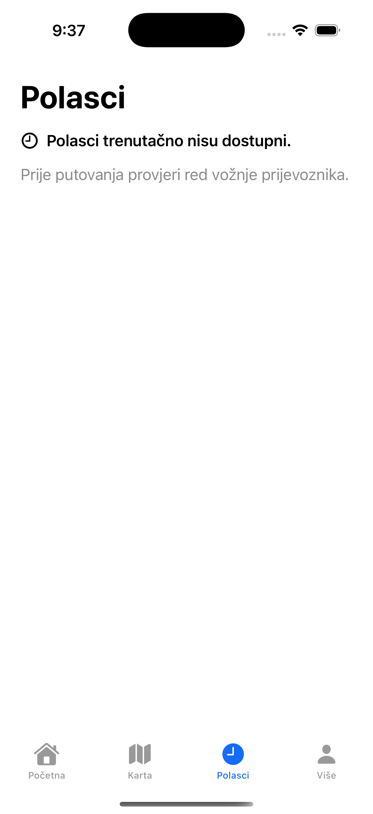
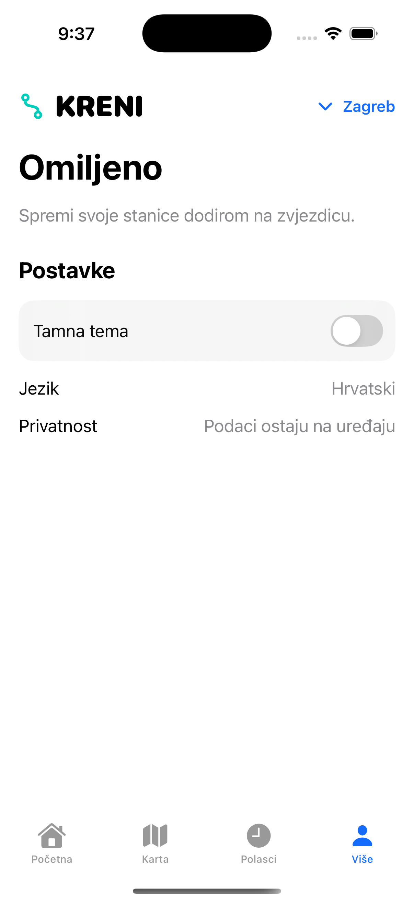

# Cijela Hrvatska. Jedno putovanje.

### Autobusi · Tramvaji · Vlakovi · Trajekti · Katamarani

**Jednostavnije putovanje od gradskih stanica do jadranskih luka.**

[**Preuzmi KRENI**](https://github.com/bren-wp/KRENI/releases) · [Android](android/) · [iOS](ios/) · [Prometni podaci](docs/DATA_SOURCES.md) · [Privatnost](docs/PRIVACY.md)

## Grad. Kolodvor. Luka. KRENI.

Svako putovanje počinje informacijom. KRENI okuplja lokacije stanica, željezničkih kolodvora i luka u prepoznatljivom, jednostavnom sučelju. Pronađi ono što ti treba, spremi omiljene lokacije i istraži prometne terminale svog grada.

Projekt je osmišljen za autobuse, tramvaje Zagreba i Osijeka, vlakove, trajekte i katamarane. Trenutačni prikazi sadrže orijentacijski katalog lokacija. **Službeni vozni redovi, GPS pozicije i multimodalne rute još nisu aktivne funkcije**; prikazivat će se samo iz dopuštenih, provjerenih izvora.

## Za putovanje bez komplikacija

| 🚏 Stanice i terminali | 🗺️ Karte | ⭐ Omiljeno |
| :--- | :--- | :--- |
| Pretraži lokacije odabranog grada | Filtriraj vrstu prijevoza | Jednim dodirom spremi važna mjesta |
| 🚉 Više načina prijevoza | 🌙 Dvije teme | 🔐 Privatnost |
| Autobusi, tramvaji, vlakovi i brodovi | Svijetli i tamni izgled | Bez računa i vlastite baze podataka |

### Stvarni zasloni aplikacije

Snimke su nastale instalacijom i pokretanjem aplikacija u Android emulatoru i iOS simulatoru; nisu ilustracije.

**ANDROID**

**IOS**

## Preuzmi aplikaciju

[**Sva izdanja — Android i iOS**](https://github.com/bren-wp/KRENI/releases)

**Android:** testno potpisani APK označen *installable-test* može se isprobati na Android uređaju. Ako je konfiguriran trajni ključ izdanja, isporučuju se potpisani distribucijski APK i AAB. Bez toga je AAB namijenjen završnom potpisivanju prije Google Playa.

**iOS:** dostupni su Xcode projekt, simulator paket, uređajska arhiva i nepotpisani IPA. **Nepotpisani IPA ne može se instalirati na obični iPhone**; za stvarnu distribuciju potreban je Apple certifikat i provisioning profil.

[**Upute za izradu, instalaciju i potpisivanje**](docs/BUILD.md)

## Dvije platforme, isti KRENI

| | Android | iOS |
| :--- | :--- | :--- |
| Sučelje | Kotlin / Jetpack Compose | Swift / SwiftUI |
| Karta | MapLibre | Apple MapKit |
| Favoriti | Privatna JSON datoteka | Privatna JSON datoteka |
| Gradovi i stanice | [Katalog](data/catalog.json) | [Katalog](data/catalog.json) |
| Automatizirane provjere | Gradle, testovi, instalacija u emulator | Xcode, pokretanje u simulatoru |

Brendiranje, sadržaj kartica i navigacija razvijaju se usporedno, uz prilagodbu standardima Androida i iOS-a.

## Pouzdani podaci, bez nagađanja

[GTFS procesor](pipeline/gtfs.py) provjerava identifikatore, prometne kalendare, vremenske zone i presjedanja. Integracije se ne uključuju bez pouzdanog izvora i dopuštenja za korištenje.

[**Izvori i licence**](docs/DATA_SOURCES.md) · [**Plan razvoja**](https://github.com/bren-wp/KRENI/issues/1)

## Privatnost i jednostavnost

Favoriti, odabrani grad i tema ostaju na uređaju. Nema obvezne prijave, vlastite baze podataka, Firebasea, Supabasea ili praćenja korisnika. Karta koristi vanjsku kartografsku uslugu objašnjenu u [pravilima privatnosti](docs/PRIVACY.md).

---

<strong>KRENI · Brendigo © 2026</strong>

[GitHub izdanja](https://github.com/bren-wp/KRENI/releases) · [Licenca](LICENSE) · [Dokumentacija](docs/BUILD.md)

