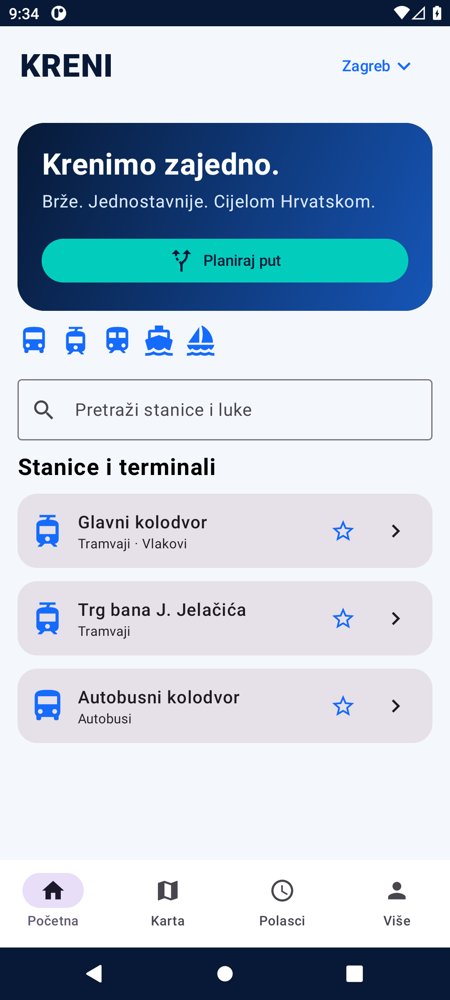
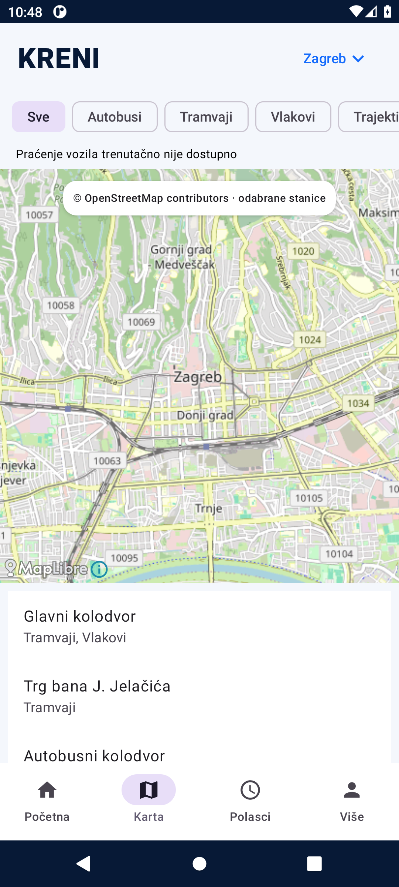
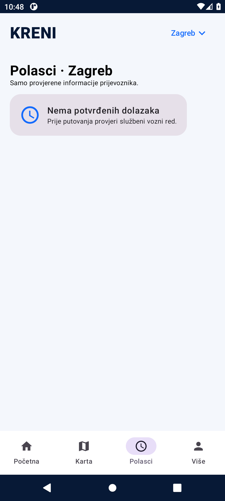
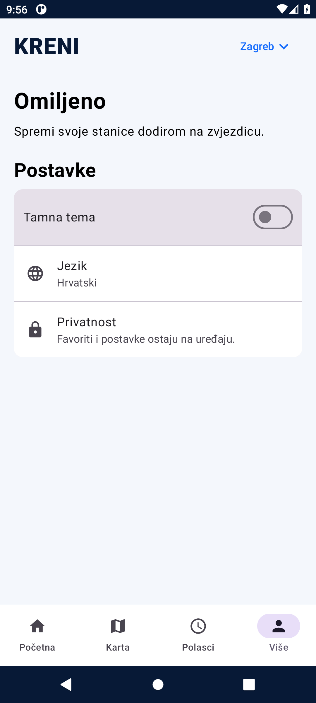

# KRENI — nativna Android aplikacija za javni prijevoz

**Autobusi · Tramvaji · Vlakovi · Trajekti · Katamarani**

[GitHub izdanja APK/AAB](https://github.com/bren-wp/KRENI/releases) · [Izvori](docs/DATA_SOURCES.md) · [Privatnost](docs/PRIVACY.md)

## Android i informacije uživo

KRENI se razvija isključivo za Android (Kotlin, Jetpack Compose, MapLibre).
Od v0.0.6 potpuno je uklonjen iOS projekt, iOS testovi i iOS izdavanje. Nema Fluttera.

Android podržava provjerene HTTPS JSON snapshot izvore i izravno dekodiranje GTFS-Realtime protobuf GPS položaja.
Kada je izvor uključen, prikazuje lokacije vozila i vrijeme zadnjeg ažuriranja, omogućuje izbor vozila i centriranje karte.
Pozicije starije od 90 sekundi se odbacuju, a mrežno osvježavanje radi samo dok je aplikacija u prvom planu.
Ne izmišljamo autobuse, njihove koordinate, dolaske, kašnjenja niti rute.

**Trenutačno nema uključenih produkcijskih GPS izvora.** ZET-ov javni GTFS-RT dostupan je samo za testiranje;
licencija i kvaliteta svakog izvora provjeravaju se prije produkcijske aktivacije.
Bez službenog GTFS Static mapiranja stanica i linija, GTFS-RT vozila prikazuju se neutralno
i bez neutemeljenih ETA procjena. Katalog terminala orijentacijski je i nije potpuna baza stajališta.

[Format integracije i uvjeti aktivacije](docs/LIVE_DATA.md) · [Izvori i licence](docs/DATA_SOURCES.md)

## Stvarni zasloni Android aplikacije

Stvarni zasloni snimljeni u Android emulatoru:

## Preuzmi aplikaciju

[Izdanja na GitHubu](https://github.com/bren-wp/KRENI/releases) sadrže testno potpisani instalacijski APK,
nepotpisani AAB ili produkcijski potpisani APK/AAB kada su postavljeni valjani ključevi.
[Upute za izradu i potpisivanje](docs/BUILD.md).

KRENI · Brendigo © 2026 · [MIT](LICENSE)

## Premium Android sučelje (v0.0.7)

Sučelje je modularizirano prema korisničkim referencama: Početna, Karta, Polasci, Planer i Više, uz uvodni zaslon. Korišten je Kotlin / Jetpack Compose s Material 3 komponentama, zadržanim MapLibre prikazom i jasnim stanjima dostupnosti podataka. Fotografski motivi korisnika učitavaju se iz lokalnih resursa `android/app/src/main/assets/brand/` ako su dostupni; pri nedostupnim fotografijama zadržan je funkcionalan gradijentni prikaz bez rušenja.

**Prikazane linije, dolasci i GPS podaci nisu simulirani.** Planiranje ruta zahtijeva provjerene GTFS podatke. Obavijesti o poremećajima onemogućene su dok ne postoji pravi izvor upozorenja.
